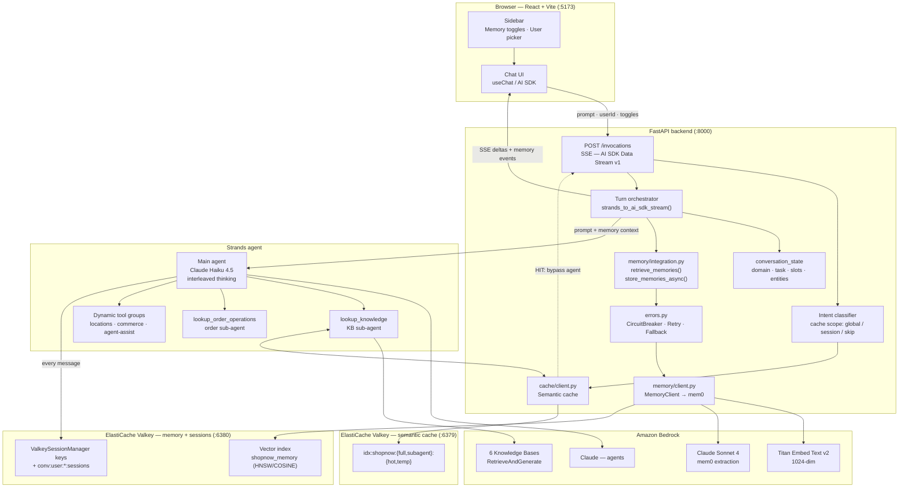
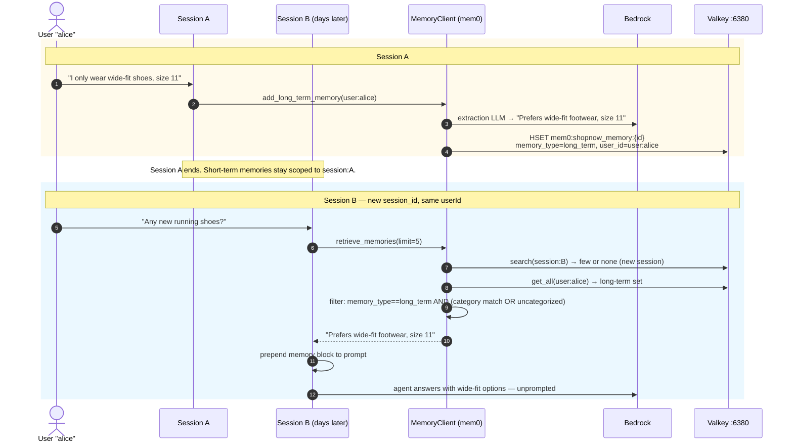
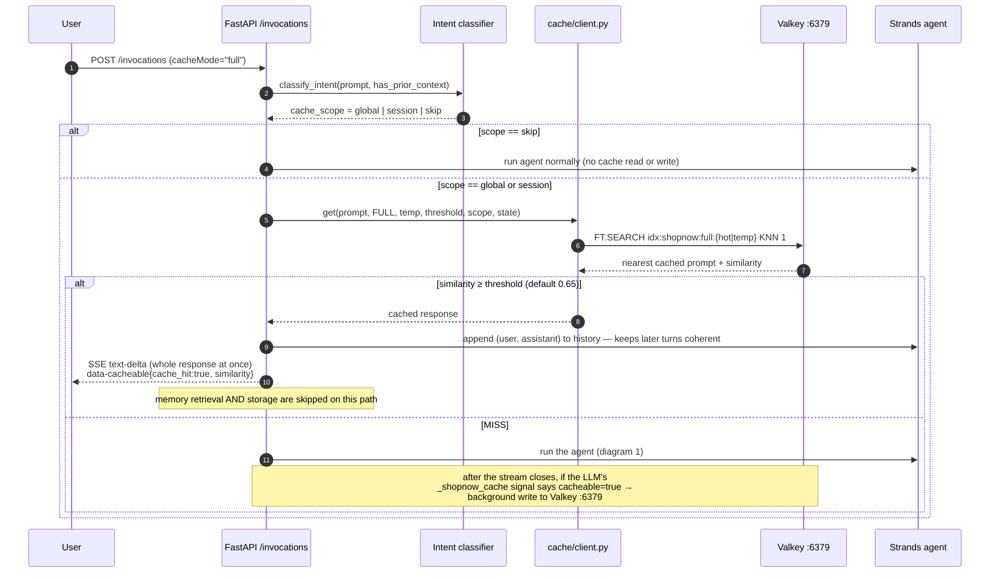
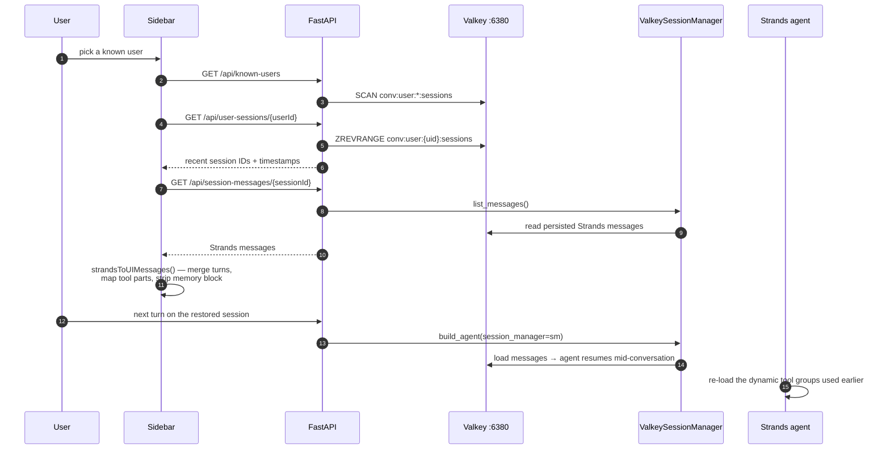
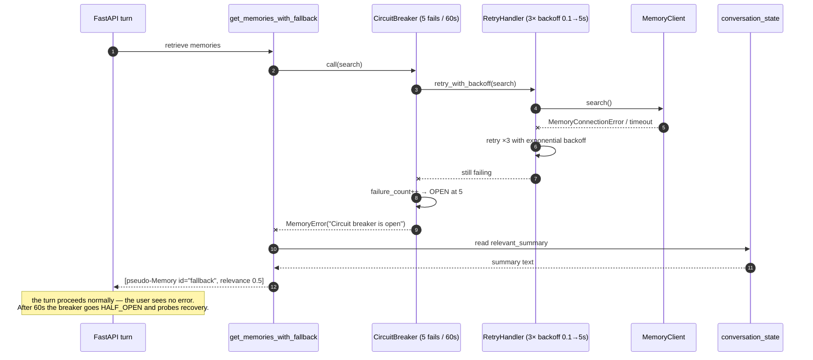

# Agentic Memory with Amazon ElastiCache for Valkey

A working reference implementation of **agentic memory** — short-term (session) and long-term (user) memory for an
LLM agent — backed by **Amazon ElastiCache for Valkey** vector search, [mem0](https://github.com/mem0ai/mem0),
[Strands Agents](https://strandsagents.com/), and Amazon Bedrock.

The demo application is *ShopNow AI*, a retail customer-support agent. It answers questions from six Bedrock
Knowledge Bases and uses Valkey for three distinct jobs:

| Job | What Valkey stores | Why it matters |
|---|---|---|
| **Agentic memory** | Vector-embedded facts extracted from conversations | The agent remembers preferences across turns *and* across sessions |
| **Session state** | Raw Strands message history | Conversations survive a backend restart and work across multiple app instances |
| **Semantic cache** | Prompt embedding → cached response | Repeat/similar questions skip the LLM entirely |

> **Scope note:** this is a demo, not production code. See [Architecture Review](#architecture-review) for a
> candid list of the gaps, shortcuts, and doc/code drift found in this repo.

---

## Table of contents

- [What this demonstrates](#what-this-demonstrates)
- [Architecture](#architecture)
- [The memory model](#the-memory-model)
- [Sequence diagrams](#sequence-diagrams)
  - [1. A turn with memory (retrieve → answer → store)](#1-a-turn-with-memory-retrieve--answer--store)
  - [2. Cross-session long-term recall](#2-cross-session-long-term-recall)
  - [3. Semantic cache hit (agent bypassed)](#3-semantic-cache-hit-agent-bypassed)
  - [4. Session resumption](#4-session-resumption)
  - [5. Graceful degradation when memory is unavailable](#5-graceful-degradation-when-memory-is-unavailable)
- [Valkey data model](#valkey-data-model)
- [Setup](#setup)
- [Configuration reference](#configuration-reference)
- [Repository layout](#repository-layout)
- [Architecture Review](#architecture-review)
- [Further reading](#further-reading)

---

## What this demonstrates

1. **Valkey as a vector database for agent memory.** ElastiCache for Valkey 8.x ships vector search
   (`FT.CREATE` / `FT.SEARCH` with HNSW). mem0's `valkey` vector-store provider writes memory embeddings there,
   so a single low-latency data store serves memory retrieval, session state, and caching.
2. **Two memory horizons with different scoping keys.** Short-term memory is keyed by `session:{session_id}`;
   long-term memory is keyed by `user:{user_id}`. Both live in the same index and are distinguished by a
   `memory_type` field in metadata.
3. **LLM-based memory extraction.** Raw conversation turns are handed to mem0, which uses Claude to decide what is
   worth remembering, deduplicate against existing memories, and issue ADD / UPDATE / DELETE operations. (An
   earlier regex-based extractor still exists in `memory/extractor.py` but is no longer on the request path.)
4. **Memory that never blocks the user.** Retrieval runs pre-turn with a timeout, wrapped in a circuit breaker
   and retry handler; storage runs post-turn as a fire-and-forget `asyncio` task. Any failure degrades to
   "no memory" instead of an error.
5. **Memory vs. cache as separate concerns.** Memory personalizes; the semantic cache elides compute. They use
   two independent Valkey clusters so their access patterns and TTLs don't interfere.
6. **Observable memory in the UI.** The React chat surfaces `🧠 N memories retrieved (ST/LT)` and `💾 N saved`
   badges per turn, plus toggles to switch each memory type on and off — which makes the effect of memory
   demonstrable side by side.

---

## Architecture



**Two clusters, on purpose.** Memory and session state live on the cluster reached at `:6380`
(`valkey-py` client, used by mem0 and `strands-valkey-session-manager`). The semantic cache lives on `:6379`
(`valkey-glide` client). Locally both are SSM port-forwarding tunnels into private-subnet ElastiCache clusters
(see [scripts/tunnels.sh](scripts/tunnels.sh)).

**Where memory is injected.** Retrieved memories are formatted as a `## Relevant Context from Memory` block and
**prepended to the user message**, not to the system prompt. That keeps the system prompt stable (better for
prompt caching) at the cost of putting memory inside the persisted conversation history — the React message
converter strips the block when rendering restored sessions.

---

## The memory model

|  | Short-term memory | Long-term memory |
|---|---|---|
| **Purpose** | Context inside one conversation | Preferences and patterns across conversations |
| **Scoping key** | `session:{session_id}` | `user:{user_id}` |
| **Enabled by** | `shortTermMemoryEnabled` (default **on**) | `longTermMemoryEnabled` (default **off**; requires a `userId`) |
| **Retrieval** | mem0 vector search (`search()`) with fallback | `get_all(user_id)` + in-Python filter — see review item 7 |
| **TTL default in code** | `MEMORY_SHORT_TERM_TTL_HOURS=720` (30 days) | `MEMORY_LONG_TERM_TTL_DAYS=90` |
| **Written by** | mem0 extraction on `add_short_term_memory_async()` | mem0 extraction on `add_long_term_memory_async()` |
| **Typical content** | "User is asking about the return window for a recent order" | "Prefers wide-fit footwear", "Planning a trip to Dublin" |

Both types share one vector index; `metadata.memory_type` (`short_term` \| `long_term`) separates them.

**Why short-term memory in Valkey at all,** when Strands already keeps the message list in process?
See [use_of_short_term.md](use_of_short_term.md) — the short version: session resumption after a restart,
multi-instance backends, keeping the context window (and token bill) small, sharing context across sub-agents,
and having an inspectable record for analytics and debugging.

**Retrieval budget.** `retrieve_memories(..., limit=5)` splits the budget across the two types, detects a product
category from the message with regex (`footwear` / `apparel` / `accessories`) to bias filtering, merges both sets,
sorts by relevance descending, and truncates to `limit`. Uncategorized long-term memories are deliberately kept
alongside category matches so cross-cutting context ("planning a trip to Dublin") still surfaces when the user
asks about shoes.

---

## Sequence diagrams

### 1. A turn with memory (retrieve → answer → store)

```mermaid
sequenceDiagram
    autonumber
    participant U as User (React UI)
    participant API as FastAPI /invocations
    participant ST as conversation_state
    participant MI as memory/integration
    participant MC as MemoryClient (mem0)
    participant BR as Bedrock (Titan + Claude)
    participant VK as Valkey :6380
    participant AG as Strands agent

    U->>API: POST /invocations {prompt, chatId, userId, toggles}
    API->>API: classify_intent() → cache scope
    Note over API: full-cache lookup happens first (diagram 3);<br/>assume MISS here
    API->>AG: get or create agent (+ ValkeySessionManager)
    API->>ST: pre_turn_update(state, prompt, turn_count)

    rect rgb(238,246,255)
    Note over MI,VK: Pre-turn retrieval — timeout-bounded, non-blocking
    API->>MI: retrieve_memories(prompt, UserIdentifier, state, limit=5)
    MI->>MC: search(query, user_id=session:{sid})
    MC->>BR: embed query (Titan v2, 1024-dim)
    MC->>VK: FT.SEARCH shopnow_memory KNN
    VK-->>MC: top-k + COSINE scores
    MI->>MC: get_all(user:{uid}) then filter in Python
    MC->>VK: read user's memory hashes
    MI-->>API: List[Memory] sorted by relevance
    end

    API-->>U: SSE data-memory-retrieved {total, short_term, long_term}
    API->>API: prompt = "## Relevant Context from Memory…" + prompt

    API->>AG: stream_async(prompt)
    AG->>BR: Claude Haiku 4.5 (+ interleaved thinking)
    AG->>AG: tool calls — lookup_knowledge, orders, …
    AG->>VK: session manager persists each message
    AG-->>API: reasoning / text / tool events
    API-->>U: SSE text-delta, tool parts, reasoning parts

    API->>ST: post_turn_update(state, tools, response)
    API-->>U: SSE data-cacheable, data-response-complete, finish

    rect rgb(240,255,240)
    Note over API,VK: Post-turn storage — fire-and-forget, after the stream closes
    API->>MI: asyncio.create_task(store_memories_async(...))
    MI->>MC: add_short_term_memory_async(session:{sid})
    MI->>MC: add_long_term_memory_async(user:{uid})
    MC->>BR: Claude Sonnet 4 decides what to remember (ADD/UPDATE/DELETE)
    MC->>BR: embed each memory (Titan v2)
    MC->>VK: HSET mem0:shopnow_memory:{id} + vector
    MI-->>API: {short_term: n, long_term: m}
    end

    U->>API: GET /memory-storage-status/{sessionId} (poll)
    API-->>U: {short_term: n, long_term: m} → 💾 badge
```

### 2. Cross-session long-term recall

This is the payoff of long-term memory: session B knows something the user only said in session A.



Long-term memory only participates when the UI sends a `userId` **and** `longTermMemoryEnabled=true`; otherwise
`UserIdentifier.authenticated_user_id` is `None` and the long-term branch is skipped entirely.

### 3. Semantic cache hit (agent bypassed)

The semantic cache sits *in front of* the whole turn, so a hit skips memory retrieval, the agent, and storage.



The agent's system prompt requires a trailing `{"_shopnow_cache": {"cacheable": bool, "reason": "…"}}` line on
every response. The backend parses and strips that line, combines it with server-side rules
(`never_cache_tools`, `ambiguous_tools`, `loader_stubs`), and only then writes to the cache. The
`lookup_knowledge` sub-agent boundary is separately cacheable at the `subagent` level — a clean seam because it
takes structured input and returns KB text with no per-user data.

### 4. Session resumption



`strands-valkey-session-manager` persists every message transparently inside the agent lifecycle — there are no
manual save calls. The `conv:user:{user_id}:sessions` sorted set is maintained separately (90-day TTL) because the
plugin has no user-level session listing.

### 5. Graceful degradation when memory is unavailable



Storage failures are even quieter: `store_memories_async` runs in a detached task, so an exception is logged and
the `💾` badge simply never appears.

---

## Valkey data model

### Memory index (cluster `:6380`)

Created at startup by `MemoryClient._create_index_workaround()`:

```
FT.CREATE shopnow_memory
  ON HASH PREFIX 1 mem0:shopnow_memory:
  SCHEMA
    memory_id   TAG
    hash        TAG
    memory      TAG
    created_at  NUMERIC
    user_id     TAG
    metadata    TAG
    embedding   VECTOR HNSW 12
                TYPE FLOAT32 DIM 1024 DISTANCE_METRIC COSINE
                M 32 EF_CONSTRUCTION 400 EF_RUNTIME 40
```

**Why the workaround exists.** mem0's Valkey provider declares a 10-field index but only writes 7 of them
(`agent_id`, `run_id`, `updated_at` are absent). On affected ElastiCache for Valkey versions, a document missing
an indexed field is silently *not indexed* — writes succeed, `FT.SEARCH` returns nothing, and memory appears to
work while recalling nothing. Creating the index with exactly the 7 written fields sidesteps it. Upstream
reference: [valkey-io/valkey-search#489](https://github.com/valkey-io/valkey-search/pull/489) (fixed in
valkey-search 1.0.2+).

### Session and index keys (cluster `:6380`)

| Key pattern | Written by | Contents |
|---|---|---|
| `mem0:shopnow_memory:{id}` | mem0 | memory hash + FLOAT32 embedding |
| Session-manager keys | `strands-valkey-session-manager` | Strands message history per session/agent |
| `conv:user:{user_id}:sessions` | `api.py` | sorted set of recent session IDs (TTL 90d) |

### Semantic cache indexes (cluster `:6379`)

Four indexes — two modes × two "temperatures":

| Index | Key prefixes | Threshold |
|---|---|---|
| `idx:shopnow:subagent:hot` / `:temp` | `shopnow:subagent:{hot,temp}:{vec,rr}:` | 0.70 |
| `idx:shopnow:full:hot` / `:temp` | `shopnow:full:{hot,temp}:{vec,rr}:` | 0.65 |

`hot` is the curated/warmed set; `temp` is scratch space that `/flush-cache` can clear mid-demo without losing the
warmed entries. `vec:` holds the embedding document, `rr:` the response record.

---

## Setup

Full walkthrough: [INITIAL_SETUP.md](INITIAL_SETUP.md). Condensed:

### Prerequisites

- AWS account with Bedrock model access enabled for **Titan Embed Text v2**, **Claude Haiku 4.5**, **Claude Sonnet 4**
- AWS CLI v2 + Session Manager plugin, Python 3.13, Node 20+, [hatch](https://hatch.pypa.io/)

### 1. Provision infrastructure

```bash
./scripts/setup_infra.sh
```

Idempotently creates a VPC (`10.0.0.0/16`), subnets, a security group (tcp/6379), an ElastiCache for Valkey
replication group with encryption at rest and in transit, an SSM-enabled jump host, the vector indexes, and
writes an `.env`. Review it before running — it creates billable resources.

### 2. Create the six Bedrock Knowledge Bases

Ingest the corpora under [data/](data/) and record each KB ID in `.env`:

| Env var | Corpus | Docs |
|---|---|---|
| `KB_PRODUCT` | `data/kb1_product_knowledge` | 95 |
| `KB_STORE_OPS` | `data/kb2_store_operations` | 46 |
| `KB_TROUBLESHOOT` | `data/kb3_troubleshooting_support_history` | 40 |
| `KB_VENDOR` | `data/kb4_vendor_seller` | 31 |
| `KB_POLICY` | `data/kb5_policies_compliance` | 30 |
| `KB_CS` | `data/kb6_customer_service` | 30 |

### 3. Open the tunnels

```bash
export SSM_INSTANCE_ID=i-xxxxxxxxxxxx
export CACHE_ENDPOINT=<cache-cluster-endpoint>
export MEMORY_CACHE_REMOTE_ENDPOINT=<memory-cluster-endpoint>
./scripts/tunnels.sh          # cache → localhost:6379, memory → localhost:6380
```

Auto-reconnecting SSM port forwards (`AWS-StartPortForwardingSessionToRemoteHost`) — no bastion SSH keys and no
publicly reachable clusters.

### 4. Run

```bash
hatch run start               # uvicorn :8000 + vite :5173
```

Open <http://localhost:5173>. In the sidebar's **🧠 Memory System** panel, enable long-term memory and enter a
user ID to exercise cross-session recall.

### Verifying memory works

```bash
curl localhost:8000/memory-storage-status/<sessionId>   # what the last turn stored
curl localhost:8000/debug/sessions                      # in-process sessions + state
curl localhost:8000/known-users                         # users with persisted sessions
```

In the UI, look for `🧠 N memories retrieved (ST/LT)` before the answer and `💾 N saved` after it.

---

## Configuration reference

These are the variables the **code actually reads** (`memory/config.py`, `cache/client.py`) — several variables
named in `docs/MEMORY_CONFIGURATION.md` are stale; see review item 2.

### Memory

| Variable | Default | Notes |
|---|---|---|
| `MEMORY_CACHE_ENDPOINT` | `localhost` | Memory/session cluster host |
| `MEMORY_CACHE_PORT` | `6380` | Tunnel port for the memory cluster |
| `MEMORY_CACHE_TLS` | `true` | TLS in transit (`valkeys://`) |
| `MEMORY_EMBEDDING_MODEL` | `amazon.titan-embed-text-v2:0` | Must match the index `DIM` |
| `MEMORY_EMBEDDING_DIM` | `1024` | |
| `MEMORY_SHORT_TERM_TTL_HOURS` | `720` | 30 days — **not** 24h as older docs say |
| `MEMORY_LONG_TERM_TTL_DAYS` | `90` | |
| `MEMORY_MAX_RETENTION_DAYS` | `365` | Retention ceiling |
| `MEMORY_SEARCH_LIMIT` | `5` | |
| `MEMORY_SEARCH_THRESHOLD` | `0.7` | Applies to the short-term vector search only |
| `MEMORY_HASH_SALT` | `default_salt` | **Set this** — the default logs a security warning |
| `MEMORY_PII_FILTERING` | `true` | Config flag only; not enforced on the live path (item 9) |
| `MEMORY_OPERATION_TIMEOUT_MS` | `150` | Retrieval budget |
| `MEMORY_ASYNC_STORAGE` | `true` | |
| `MEMORY_ENABLED` / `MEMORY_SHORT_TERM_ENABLED` / `MEMORY_LONG_TERM_ENABLED` | `true` | Overridden per-request by the UI toggles (item 11) |
| `AWS_REGION` | — | Bedrock + ElastiCache region |

### Semantic cache and Knowledge Bases

| Variable | Default | Notes |
|---|---|---|
| `SHOPNOW_CACHE_ENDPOINT` | `localhost` | Cache cluster host |
| `SHOPNOW_CACHE_PORT` | `6379` | |
| `KB_PRODUCT`, `KB_STORE_OPS`, `KB_TROUBLESHOOT`, `KB_VENDOR`, `KB_POLICY`, `KB_CS` | — | Bedrock Knowledge Base IDs |

Per-request knobs (sent by the UI, read from the `/invocations` body): `cacheMode`, `fullCacheTemp`,
`kbCacheTemp`, `fullCacheThreshold` (0.65), `kbCacheThreshold` (0.70), `kbCacheEnabled`,
`shortTermMemoryEnabled`, `longTermMemoryEnabled`, `userId`.

---

## Repository layout

```
src/agentic_shopping_demo/
  api.py                    FastAPI app, turn orchestration, SSE, all endpoints
  agent.py                  Strands agent construction, system prompt, tool registry
  memory/
    config.py               MemoryConfig.from_env() + validation
    client.py               MemoryClient — mem0 wrapper, index workaround, add/search/expire
    integration.py          retrieve_memories() / store_memories_async() — the live path
    user_identifier.py      user: / anon: / session: scoping, anonymous→auth migration
    errors.py               CircuitBreaker, RetryHandler, fallback-to-state
    models.py               Memory, MemoryType, MemoryCandidate
    privacy.py              PII redaction, SHA-256 hashing, GDPR export  (off the live path)
    extractor.py            legacy regex extractor                      (off the live path)
    lifecycle.py            expiration sweeps                           (off the live path)
    metrics.py              counters/timers                             (off the live path)
    api_routes.py           /memory/* REST router                       (never mounted — item 3)
    conversation_store.py   superseded by strands-valkey-session-manager
  cache/client.py           Semantic cache (valkey-glide, 4 indexes)
  tools/                    KB sub-agent, order sub-agent, dynamic tool groups
react-ui/                   React + Vite chat, memory badges, session sidebar
scripts/                    setup_infra.sh, tunnels.sh, index creation
data/                       6 Knowledge Base corpora (272 documents)
docs/                       Deep-dive docs (see Further reading)
```

---

## Architecture Review

### What holds up well

- **Memory is genuinely non-blocking.** Retrieval is timeout-bounded behind a circuit breaker with a
  conversation-state fallback; storage is a detached task after the stream closes. Memory can be completely down
  and the chat still works. That's the right default for a user-facing agent.
- **Correct scoping primitive.** `UserIdentifier` producing `user:` / `anon:` / `session:` prefixes — with an
  anonymous→authenticated migration path — is a small abstraction that prevents a large class of
  cross-user memory-leak bugs.
- **Delegating extraction to an LLM.** Replacing the regex extractor with mem0's LLM extraction removed a
  perpetual pattern-maintenance burden and handles implicit and multi-turn preferences that regex cannot.
- **Cache and memory are properly separated,** on distinct clusters with distinct clients, thresholds, and TTLs.
  Conflating "remember this user" with "reuse this answer" is a common design error this repo avoids.
- **The ElastiCache index workaround is documented in code,** with the upstream PR reference and the failure mode
  it prevents — exactly how a silent-failure workaround should be recorded.
- **The sub-agent boundary is a deliberate cache seam.** Collapsing six KB tools behind one `lookup_knowledge`
  tool yields a stable, PII-free input/output contract to cache against.
- **Memory is observable in the UI,** which turns an otherwise invisible subsystem into something a reviewer can
  verify turn by turn.

### Findings

Ordered roughly by impact. Items 1–6 are correctness/accuracy issues; 7–13 are design limits; 14 is hygiene.

1. **Short-term TTL is 30 days, not 24 hours.** `MEMORY_SHORT_TERM_TTL_HOURS` defaults to `720`
   ([memory/config.py](src/agentic_shopping_demo/memory/config.py)), while
   [memory/\_\_init\_\_.py](src/agentic_shopping_demo/memory/__init__.py), `docs/MEMORY_SYSTEM.md`, and other docs
   still say 24h. A "short-term" memory that outlives a month is functionally a second long-term store with
   different scoping — either lower the default or rename the concept.
2. **Documented env vars don't match the code.** `docs/MEMORY_CONFIGURATION.md` documents
   `MEMORY_CLUSTER_ENDPOINT`, `MEMORY_CLUSTER_PORT`, `MEMORY_TLS_ENABLED`, and `MEMORY_AWS_REGION`; the code reads
   `MEMORY_CACHE_ENDPOINT`, `MEMORY_CACHE_PORT`, `MEMORY_CACHE_TLS`, and `AWS_REGION`. Several other documented
   variables (connection-pool size, cache TTL, audit logging, search timeout) are never read at all. Anyone
   following the doc silently gets defaults.
3. **The `/memory/*` REST API is unreachable.** [memory/api_routes.py](src/agentic_shopping_demo/memory/api_routes.py)
   defines a full router (add / search / patch / delete / delete-user / export / health) but no `include_router`
   call exists anywhere in the app. Every endpoint documented for direct memory management returns 404.
4. **Two conflicting memory index definitions.** [scripts/create_memory_indexes.py](scripts/create_memory_indexes.py)
   creates `idx:shopnow:memory` with prefix `shopnow:memory:vec:`; the runtime creates `shopnow_memory` with
   prefix `mem0:shopnow_memory:`. Only the runtime one is read. The script is a trap.
5. **Docs reference files and infrastructure that don't exist.** `fix_index_for_elasticache.py` and
   `scripts/setup_memory_cluster.sh` are named in docs but absent (the real script is
   [scripts/setup_infra.sh](scripts/setup_infra.sh)). `docs/MEMORY_DEPLOYMENT.md` describes a `10.1.0.0/16` VPC
   with 2× `cache.r7g.xlarge`, while the script builds `10.0.0.0/16` with 1× `cache.t3.micro`.
6. **Model references have drifted.** The code runs Claude **Haiku 4.5** as the main agent and **Sonnet 4** as
   mem0's extraction LLM; several docs and the `.drawio` diagrams say Sonnet 4.5. The extraction model is a
   quality/cost lever worth stating accurately — it decides what gets remembered at all.
7. **Long-term retrieval doesn't use vector search.** `retrieve_memories` calls `client.get_all(user_id)` and
   filters in Python on `memory_type` and category. Consequences: `MEMORY_SEARCH_THRESHOLD` has no effect on
   long-term recall, ranking is weaker than the short-term path, and cost grows linearly with a user's memory
   count. Fine for a demo user with a handful of memories; it will not scale to hundreds. The likely root cause is
   item 8.
8. **Metadata filtering is disabled at the index level.** `client.search()` drops the `domain` filter
   ("domain is not indexed as a TAG field in Valkey") and no longer filters on `expires_at`, so
   expired-but-present memories can be returned and the regex category detection in `integration.py` is doing work
   the index should do. Adding `memory_type`, `domain`, and `category` as TAG fields — and `expires_at` as
   NUMERIC — would let long-term retrieval become a real filtered KNN query and fix 7 and 8 together.
9. **PII protection is implemented but not wired in.** [memory/privacy.py](src/agentic_shopping_demo/memory/privacy.py)
   has a solid `PIIFilter`, `SensitiveDataHasher`, and `MemoryContentSanitizer`, and `MEMORY_PII_FILTERING`
   defaults to `true` — but `store_memories_async()` passes raw user and assistant text straight to mem0. Nothing
   redacts emails, phone numbers, or card numbers before they are embedded and persisted. For a sample that
   teaches memory design this is the most important gap to close: sanitize in `store_memories_async` before the
   `add_*` calls.
10. **`MEMORY_HASH_SALT` defaults to `default_salt`,** and `SensitiveDataHasher` has its own hardcoded fallback
    salt. Effectively-unsalted SHA-256 of an order ID or tracking number is reversible by enumeration.
11. **Config-level enable flags are bypassed.** `MemoryConfig.enabled`, `short_term_enabled`, and
    `long_term_enabled` exist, but `/invocations` decides purely from the per-request `shortTermMemoryEnabled` /
    `longTermMemoryEnabled` body fields. An operator who sets `MEMORY_ENABLED=false` still sees memory traffic.
    The request should be gated on the `AND` of both.
12. **In-process dicts still gate the memory path.** Retrieval and storage only run inside
    `if session_id in conversation_metadata`, and `sessions` / `conversation_metadata` / `memory_storage_results`
    are module-level dicts. Despite `ValkeySessionManager` persisting messages, a turn routed to a fresh instance
    skips memory entirely and the `💾` badge poll can miss. `conversation_state` also lives only in process —
    moving it to Valkey would make the multi-instance story real.
13. **Memory is injected into the user message.** Prepending `## Relevant Context from Memory` to the prompt means
    the block is persisted into conversation history and re-sent on every later turn, compounding token cost — and
    the UI has to strip it when rendering restored sessions (`messageConverter.ts`). `inject_memory_context()`
    already exists to put it in the system prompt instead; that trade (prompt-cache invalidation vs. history
    pollution) should be a documented, deliberate choice.
14. **Repo hygiene and hardcoded environment identifiers.** `backend.log`, `venv/`, `react-ui/dist`, Gradle lock
    files, and `brazil.ion` (a leftover from an internal build system) are committed. Docs contain a real AWS
    account ID, an EC2 instance ID, and full ElastiCache endpoint hostnames. These should be genericized and
    `.gitignore`d before this is published as a public sample.

### Suggested order of work

1. Wire the sanitizer into `store_memories_async` and require a real `MEMORY_HASH_SALT` (items 9, 10).
2. Add the missing TAG/NUMERIC fields to the index and convert long-term retrieval to a filtered KNN query
   (items 7, 8).
3. Reconcile the docs with the code: env vars, TTLs, model IDs, missing files, infra sizing (items 1, 2, 5, 6).
4. Either mount the `/memory/*` router or delete it; delete `scripts/create_memory_indexes.py` or fix it to match
   the runtime index (items 3, 4).
5. Move `conversation_state` and the memory-storage results into Valkey; gate memory on config `AND` request
   (items 11, 12).
6. Scrub committed artifacts and environment identifiers (item 14).

---

## Further reading

| Doc | Contents |
|---|---|
| [INITIAL_SETUP.md](INITIAL_SETUP.md) | End-to-end setup: prerequisites, Bedrock access, KBs, tunnels, run |
| [docs/MEMORY_SYSTEM.md](docs/MEMORY_SYSTEM.md) | Memory subsystem design deep dive |
| [docs/MEMORY_QUICK_START.md](docs/MEMORY_QUICK_START.md) | Fastest path to a working memory demo |
| [docs/LONG_TERM_MEMORY_GUIDE.md](docs/LONG_TERM_MEMORY_GUIDE.md) | Cross-session recall behavior and tuning |
| [docs/MEMORY_CONFIGURATION.md](docs/MEMORY_CONFIGURATION.md) | Configuration reference (verify against item 2) |
| [docs/MEMORY_UI_GUIDE.md](docs/MEMORY_UI_GUIDE.md) | Memory toggles, badges, user picker |
| [docs/MEMORY_DEPLOYMENT.md](docs/MEMORY_DEPLOYMENT.md) | Cluster deployment notes (verify against item 5) |
| [docs/MEMORY_IMPLEMENTATION_SUMMARY.md](docs/MEMORY_IMPLEMENTATION_SUMMARY.md) | Implementation notes and decisions |
| [docs/CACHE_CONTROLS_DIAGNOSTIC.md](docs/CACHE_CONTROLS_DIAGNOSTIC.md) | Semantic cache controls and troubleshooting |
| [docs/COMPREHENSIVE_TEST_PLAN.md](docs/COMPREHENSIVE_TEST_PLAN.md) | Manual test matrix |
| [use_of_short_term.md](use_of_short_term.md) | Why short-term memory belongs in Valkey, not just in process |
| [changes_over_siva_version.md](changes_over_siva_version.md) | Changelog vs. the original codebase |
| [DEVELOPING.md](DEVELOPING.md) | Local development workflow |

---

## License

Part of the [amazon-elasticache-samples](../README.md) repository — MIT-0.
